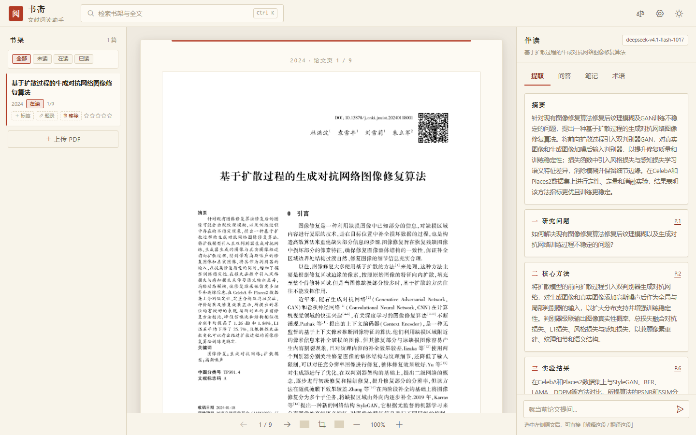
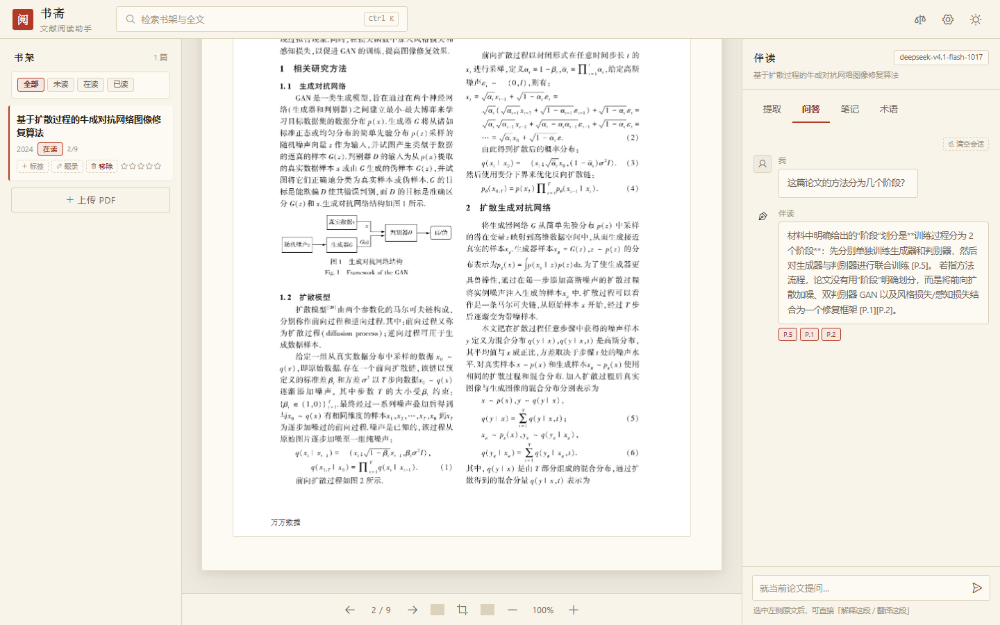
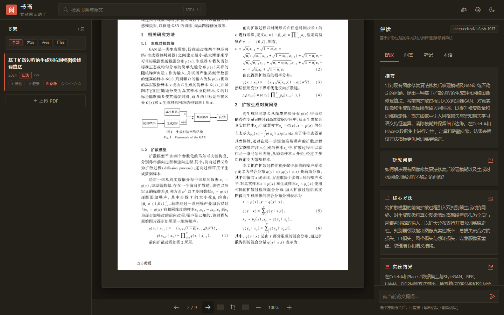

# 书斋 · 文献阅读助手

一个跑在本地的论文精读工具：把 PDF 拖进来，在浏览器里逐页读，AI 帮你把一篇论文拆成研究问题、核心方法、实验结果、主要贡献，边读边问、边读边记。

纯前端实现，没有后端、没有账号：论文和笔记数据只存在你自己的浏览器里（IndexedDB），AI 请求从浏览器直接发给你自己配置的服务，不经过任何中间层。



## 功能

**阅读器** —— pdf.js 逐页渲染，翻页、缩放、适应宽度，文本可选中；阅读进度自动记忆，下次打开接着上次的页码继续。`←` `→` 翻页，`Ctrl K` 全文检索。

**书架** —— 拖入 PDF 自动解析页数、预填题录（标题 / 作者 / 年份 / DOI，识别不准可手改）；未读、在读、已读三种状态，配合标签与星级筛选陈列。

**伴读面板** —— 打开一篇文献后，右侧提供四类工具：

- **提取**：一键生成摘要与四要素，每项标注原文页码，点页码跳回原文；
- **问答**：就当前论文提问。回答基于论文原文（按问题相关性检索相关页作为上下文，不整篇塞给模型），关键论断带 `[P.x]` 引用，点击跳页并尝试高亮原文；
- **笔记**：选中一段原文即可记笔记，锚定页码与引文，点击笔记跳回原文并高亮；也支持不锚定页码的全局笔记；
- **术语**：自动提取术语与数学符号，附中文释义与出处页码。

**划词与图表** —— 选中文本后出现操作菜单：解释这段、翻译这段、记笔记；选中的内容含公式时会额外出现「解释公式」，由 KaTeX 渲染并逐符号讲解。工具栏的框选模式可以框住一张图表，交给视觉模型读图，给出图注与数据要点，解读结果可以一键存为笔记。



**导出** —— Markdown 精读卡片（题录 + 摘要 + 四要素 + 读书笔记）、跨文献对比表（选 2~4 篇，AI 按维度填表、格子可手改）、Anki 牌组文本（含四要素、术语、符号、笔记卡片，Anki 2.1.55+ 可直接导入）、APA 7 与 GB/T 7714 引文复制。

**备份** —— 设置页可把全部数据（含 PDF 原件）打包成一个 JSON 备份，也可整库还原，换电脑或清浏览器缓存前导出一份即可。

暗色模式跟随主题切换，纸页永远保持纸的颜色。



## 运行

需要 Node.js 20.19+（或 22.12+），包管理器为 npm。

```bash
npm install
npm run dev
```

打开 `http://localhost:5173`。AI 功能需要在项目根目录放一个 `.env`（可参照 `.env.example`）：

```env
VITE_AI_BASE_URL=https://tokenrhythm.studio/v1
VITE_AI_MODEL=deepseek-v4.1-flash-1017
VITE_AI_API_KEY=你的key
```

默认指向基元律动（TokenRhythm）的 OpenAI 协议接口，支持视觉能力（用于图表解读）。任何兼容 OpenAI `/chat/completions` 协议的服务都可以接入——不改 `.env`，直接在应用的「设置」页里填 Base URL / 模型 / Key 也行，连接测试可以当场验证。Key 只保存在本机，不会出现在任何导出文件里。

没有配置 Key 时，阅读、笔记、书架管理照常可用，AI 相关入口会提示先去配置。

## 几点说明

- 所有数据存于浏览器 IndexedDB（库名 `paper-study`），与浏览器绑定；清除浏览器数据前记得先导出备份。
- 中文论文全程支持（文本提取、检索、问答、定位都针对中文做了处理）；扫描版 PDF 没有文本层，可以阅读，但 AI 功能会明确提示不可用。
- 问答与提取的上下文按相关性裁剪，长论文也不会整篇发送，省钱也更快。
- 拒绝服务或连接失败时会有具体的错误分类提示（401 / 404 / 超时等），并预留了本地开发代理开关。

## 技术栈

Vue 3 · TypeScript · Vite · Pinia · Tailwind CSS 4 · pdf.js · KaTeX · GSAP · IndexedDB
